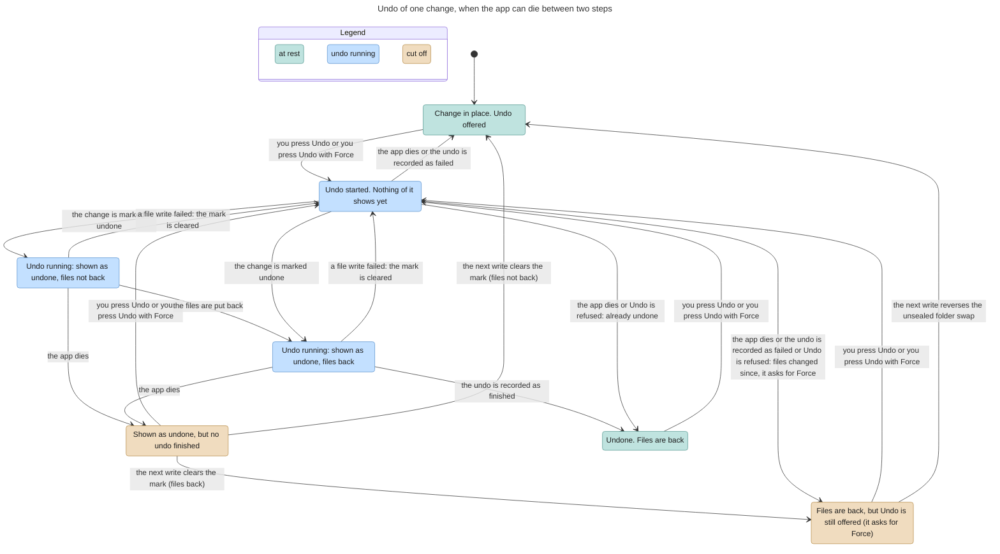
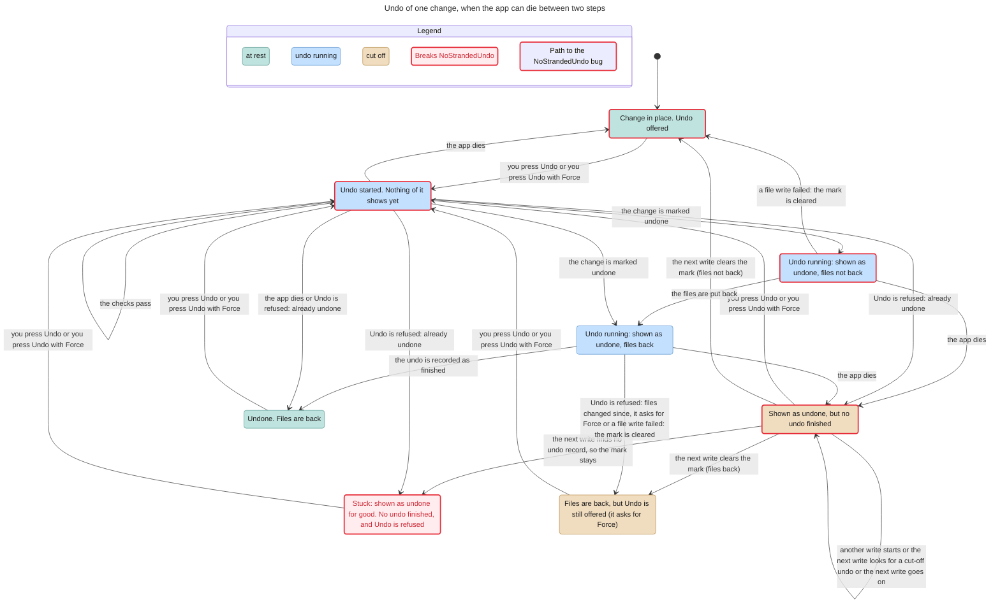

# Undo, as a state chart

These charts show what a user can see while one change is undone: what
Activity shows, whether Undo is offered, and whether the files are back. The
arrows are what the user does and what the app does, including the app dying
between two steps. The `/pstack-statechart` skill drew them from
[model/UndoClaim.tla](model/UndoClaim.tla) and the words in
[model/view.mjs](model/view.mjs). [SKILL.md](SKILL.md) says how to draw them
again.

Colors: teal is at rest, blue is an undo that is running, yellow is an undo
that was cut off. A red state breaks a rule, and a red border marks the
shortest path to it.

## A change the core wrote

Undo from Activity, `skill-studio restore` or the MCP tool `restore_event`,
for a change such as an update, a remove or an invocation change. This chart
is the undo that swaps a whole folder back, as for an update, with the swap
landing at once. Every rule holds.

What to notice:

- An undo that was cut off leaves the change shown as undone until the next
  write starts. That write clears the mark, and Undo is offered again.
- If the app dies after the files are back but before the undo is recorded as
  finished, the files stay back and Undo is still offered. Pressing it asks
  for Force, because the files no longer match the change.
- A folder swap that was not sealed is reversed by the next write, or when
  the desktop app starts again.

## A change the desktop wrote

Undo from Activity for a change the desktop's own event store wrote, such as
a link repair or a frontmatter repair made in the app. This chart is the
undo whose write lands at once. The rule `NoStrandedUndo` breaks: the red
state.

The shortest path to the red state:

1. You press Undo.
2. The desktop marks the change as undone. It has not recorded the undo yet.
3. The app dies.
4. The next write looks for a cut-off undo to clear. It finds no undo record,
   so the mark stays.
5. The change is shown as undone for good. No undo finished, the files are
   not back, and Undo is refused.

## What the charts leave out

- Steps that do not change what the user can see, such as a check that
  passes.
- A recovery pass that starts when nothing is left to recover. The core chart
  also leaves out the desktop app starting again: it marks a cut-off undo and
  reverses an unsealed folder swap, as the next write does, but it does not
  clear the mark.
- A write that is caught half way. Most undo writes are not one atomic
  operation: the core removes an installed folder entry by entry, and the
  desktop removes the live path before it puts the old one in. If the app
  dies in between, the files are half put back and the change is still shown
  as undone. After the next write clears the mark, Undo is offered again and
  asks for Force. The check covers this; the charts would have about 30
  arrows with it.
- The charts use 2 Undo requests and 1 crash. The check uses 3 and 2.
