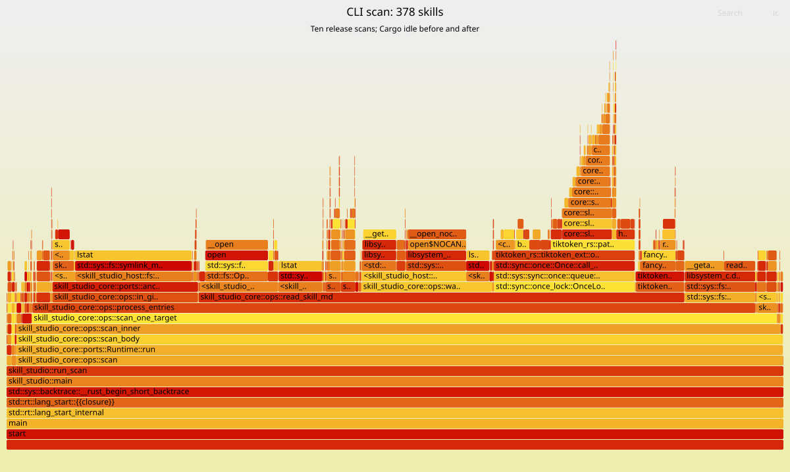

# Real-shaped scan profile

Release CLI scan, 378 skills, seed 1, ten complete scans.

Source commit: `15c1fbda980cb84d05bd51bd04c9b1d475bc540e`.

Hardware: Apple M3 Max; 36 GiB RAM.

Executable SHA-256: `25d802bf3ee7eb7c2f7eae651cb5e038c287038baa1a79cadf20999f4a89341e`.

Recorded: 2026-11-10T04:22:35.298667+00:00. Load average: `{ 8.38 11.62 17.04 }`.

Cargo processes before/after: 0/0.

DEVELOPER_DIR: `/Library/Developer/CommandLineTools`.



The table counts main-thread leaf samples. It does not measure CPU percentages. Unresolved frames stay in the denominator.

| Leaf frame                          | Samples | Share |
| ----------------------------------- | ------: | ----: |
| `lstat`                             |     399 | 25.0% |
| `__open_nocancel`                   |     139 |  8.7% |
| `__open`                            |     134 |  8.4% |
| `__getattrlist`                     |      98 |  6.1% |
| `libsystem_malloc.dylib unresolved` |      91 |  5.7% |

Total nonempty main-thread stacks: 1599.

Filesystem calls dominate the sampled work. A cache needs invalidation and scope-safety proof before it can be a clear win. No scan hot-spot fix is included here.

The compressed Samply profile and symbol sidecar preserve the full trace. The SVG uses the same folded stacks and the standard [FlameGraph renderer](https://github.com/brendangregg/FlameGraph).

Regenerate the table and folded stacks with:

```sh
python3 tools/perf-profile-summary.py docs/perf/real-shaped-profile.json.gz
```
